# Solar-PCNN Research

**Physics-constrained neural networks for solar PV forecasting — reproduce, diagnose, improve, validate.**

This repository reproduces a Physics-Constrained Neural Network (PCNN) for solar power forecasting, then extends it with an **Adaptive Residual PCNN (AR-PCNN)** and **cross-domain multi-task learning** so the model works better when weather data and power labels come from different sources.

> **Docs:** all phase reports, `summary.md`, `interpret.md`, and `requirements.txt` live in [`Documentation/`](Documentation/README.md). Root `requirements.txt` installs from that list.

> **One-line result:** Multi-task AR-PCNN lifts Renewables.ninja R² from ~0.5 → **~0.86** (cleaner val-holdout ~**0.81**). NSRDB physics-target scores stay near-perfect as a **consistency check** (labels are physics-derived — not a forecasting claim). Phase 8 audit: **178/178** metric checks pass.

---

## Table of contents

1. [What problem we solve](#1-what-problem-we-solve)
2. [Big picture architecture](#2-big-picture-architecture)
3. [Project story (Phases 1–9)](#3-project-story-phases-19)
4. [Models explained simply](#4-models-explained-simply)
5. [Results & comparisons](#5-results--comparisons)
6. [Figures gallery](#6-figures-gallery)
7. [Repository layout](#7-repository-layout)
8. [Setup & how to run](#8-setup--how-to-run)
9. [Data & splits](#9-data--splits)
10. [Important caveats](#10-important-caveats)
11. [Documentation index](#11-documentation-index)

---

## 1. What problem we solve

Solar power depends on weather (sunlight, temperature, …). A pure neural net can fit training data but may:

- break physical limits (negative power, over capacity),
- ignore known physics equations,
- fail when the **label source changes** (e.g. NSRDB weather → Renewables.ninja power).

We want a model that:

1. **Respects physics** (non-negative, capacity bounds),
2. **Uses an analytical PV prior** when it is trustworthy,
3. **Corrects** that prior with a learned residual + gate,
4. **Transfers** better to an external PV dataset via multi-task learning,
5. **Reports uncertainty** with calibrated intervals (PICP ≈ 95%).

---

## 2. Big picture architecture

### End-to-end research pipeline

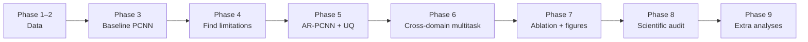

### Proposed model (AR-PCNN + optional external head)

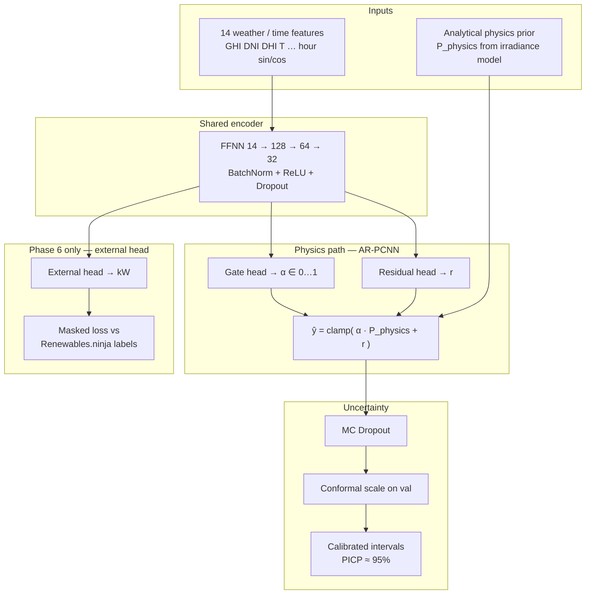

**Plain language:**  
The encoder reads weather. The **gate α** decides how much to trust the physics formula. The **residual r** fills the gap. Phase 6 adds a small **ninja kW head** on the same encoder so the network also learns the external system — without rewriting the physics path.

### What each model is

| Model | Formula / idea | When we use it |
|-------|----------------|----------------|
| **A — Original PCNN** | Dual-branch FFNN × physics gate (paper baseline) | Frozen baseline |
| **B — Residual only** | `ŷ = clamp(P + r)`, α fixed to 1 | Ablation |
| **C — Residual + Gate** | `ŷ = clamp(α·P + r)` | Core AR-PCNN |
| **D — C + Calibrated UQ** | Same weights as C; conformal MC Dropout | Uncertainty claims |
| **E — Multitask CD** | C’s physics path + external kW head | Cross-domain result |

Architecture is **frozen** from Phase 5/6 onward. Later phases only validate and analyse.

---

## 3. Project story (Phases 1–9)

| Phase | What we did | Outcome |
|-------|-------------|---------|
| **1** | Collect NSRDB 2016–2020 + Renewables.ninja 2019 | Raw data ready |
| **2** | Clean, physics target, chronological split, train-only scaler | 28,062 / 7,016 / 8,770 |
| **3** | Reproduce paper PCNN in PyTorch | NSRDB fidelity R²≈0.998; Ninja≈0.54 (no paper-number alignment claimed) |
| **4** | Diagnose failures | Physics-label copying; weak ninja transfer; UQ too wide |
| **5** | AR-PCNN + conformal UQ | Gate α≈0.94; PICP≈0.94; Ninja still ~0.49 |
| **6** | Multi-task + failed fine-tune | **Ninja R²≈0.86**; fine-tune failed (useful negative) |
| **7** | Ablation A–E, interpretability, stats, publication figures | Each piece isolated |
| **8** | Independent metric audit from saved arrays | **178/178 PASS** |
| **9** | Extra analyses (gate, residual, noise, regimes, …) | Evidence pack; see [`Documentation/phase9_report.md`](Documentation/phase9_report.md) |

---

## 4. Models explained simply

### Baseline PCNN (Phase 3)

- Dual branch: data encoder + physics fusion.
- Loss: MSE + capacity + non-negativity penalties.
- Good on NSRDB; mediocre on ninja; uncertainty bands too wide (PICP≈0.999).

### AR-PCNN (Phase 5)

\[
\hat{y} = \mathrm{clamp}\big(\alpha \cdot P_{\mathrm{physics}} + r\big)
\]

- **α (gate):** high by day → trust physics; more variable at night.
- **r (residual):** tiny on NSRDB (labels ≈ physics).
- **UQ:** MC Dropout + conformal scaling on validation → test PICP≈0.94.

### Cross-domain AR-PCNN (Phase 6)

- Same physics path as Phase 5.
- Extra head predicts **system kW** for Renewables.ninja.
- Loss: physics loss + `λ_external × masked_ninja_MSE` (only hours with ninja labels).
- **Multi-task works.** Frozen-encoder fine-tune does **not**.

---

## 5. Results & comparisons

> **Lead claim:** Ninja multitask transfer (prefer **val-holdout R² ≈ 0.81**; full-2019 ≈ 0.86).  
> NSRDB R² ≈ 1.0 + MAE (W) is a **physics-fidelity sanity check** only — labels are physics-derived. Do not write literal `R² = 1.0000`.  
> Model **D** reuses **C** weights (calibration only) — not a separately trained model.

### 5.1 Main comparison table

| Model | Ninja R² (—) | NSRDB R² (—) | NSRDB MAE (W) | Feasible† | PICP note |
|-------|--------------|--------------|---------------|-----------|-----------|
| A PCNN | 0.54 | 0.9976 | 2.29 | 1.00 | Raw MC ≈ 0.999 (too wide) |
| B Residual only | 0.49 | ≈1.0 | ~0 | 1.00 | — |
| C Residual + Gate | 0.49 | ≈1.0 | ~0 | 1.00 | Raw MC under-covered |
| D C + Calibrated UQ | 0.49 | ≈1.0 | ~0 | 1.00 | **Calibrated ≈ 0.95** |
| E Multitask CD | **0.86** | ≈1.0 | ~0.0003 | 1.00 | Calibrated ≈ 0.96 |

† `Feasible = 1.0` is by hard clamp in the forward pass (architecture), not a learned score.  
**Units:** NSRDB MAE is **W** (single TS250 panel). Ninja R² is on a **10 kW** system (electricity in **kW**). Do not convert source-paper absolute MAE (e.g. 0.0213) into our tables — capacity/unit there is **not reconcilable**.

**What this table means in plain language**

- Residual/gate make NSRDB reconstruction nearly exact — expected when labels ≈ physics (Phase 4).
- **Gating alone does not fix domain shift** (Ninja stays ~0.49).
- **Calibration** fixes interval coverage without changing point predictions.
- **Multi-task** is what lifts Ninja performance — the actual contribution.

### 5.2 Phase 5 — PCNN vs AR-PCNN

| Metric | PCNN | AR-PCNN |
|--------|------|---------|
| NSRDB MAE (W) | 2.29 | ~0.0001 |
| NSRDB R² | 0.9976 | ≈1.0 |
| Ninja R² | 0.54 | 0.49 |
| Mean α | — | 0.937 |
| PICP (calibrated for AR) | 0.999 raw | **0.944** |

Full table: [`Documentation/phase5_comparison.md`](Documentation/phase5_comparison.md)

### 5.3 Phase 6 — Cross-domain

| Metric | PCNN | AR-PCNN | CD Multitask | CD Finetune |
|--------|------|---------|--------------|-------------|
| Ninja R² (full 2019) | 0.54 | 0.49 | **0.86** | −0.51 |
| Ninja R² (val holdout) | — | — | **0.81** | −0.51 |
| NSRDB R² | 0.998 | ≈1.0 | ≈1.0 | ≈1.0 |

Full table: [`Documentation/phase6_comparison.md`](Documentation/phase6_comparison.md)

### 5.4 Ablation takeaway (Phase 7)

```text
Physics reconstruction  →  residual / gate
Trustworthy intervals   →  conformal UQ
Cross-domain Ninja gain →  multi-task external head
```

Details: [`Documentation/phase7_validation.md`](Documentation/phase7_validation.md)

### 5.5 Audit (Phase 8)

Independent recalculation of MAE / RMSE / R² / MAPE / sMAPE / nRMSE / PICP / MPIW from saved prediction arrays — **no hard-coded table numbers**.

- Result: **178/178 PASS**, publication readiness **READY with caveats**
- Report: [`Documentation/phase8_audit.md`](Documentation/phase8_audit.md)

---

## 6. Figures gallery

### Architecture & workflow

| Figure | Path |
|--------|------|
| Architecture schematic | 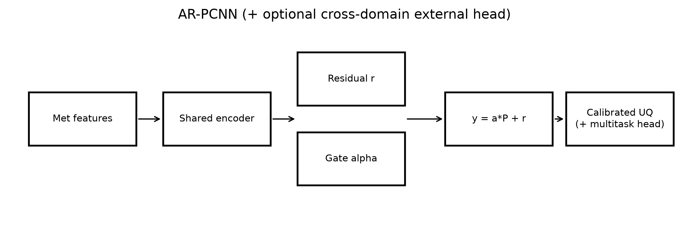 |
| Validation workflow | 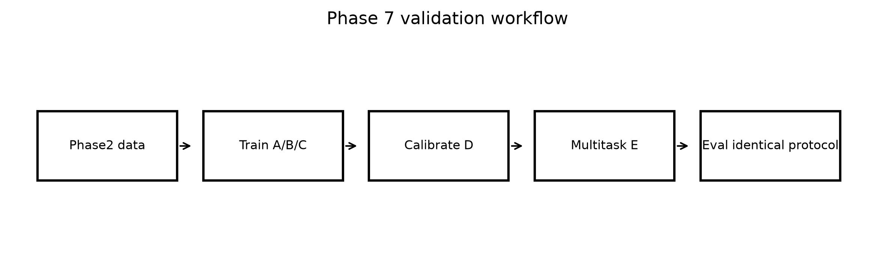 |

### Ablation & uncertainty

| Figure | Path |
|--------|------|
| Ablation bars (R² / Ninja / PICP) | 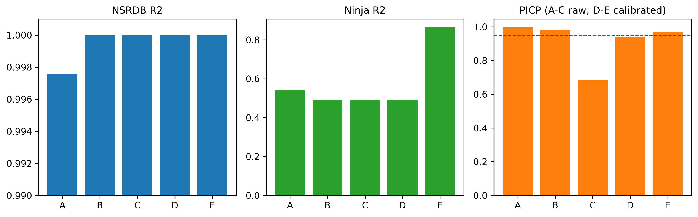 |
| Uncertainty calibration (Model D) | 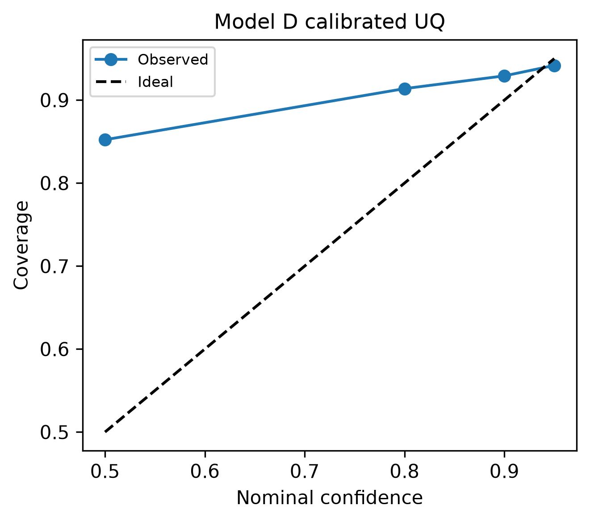 |
| Error analysis | 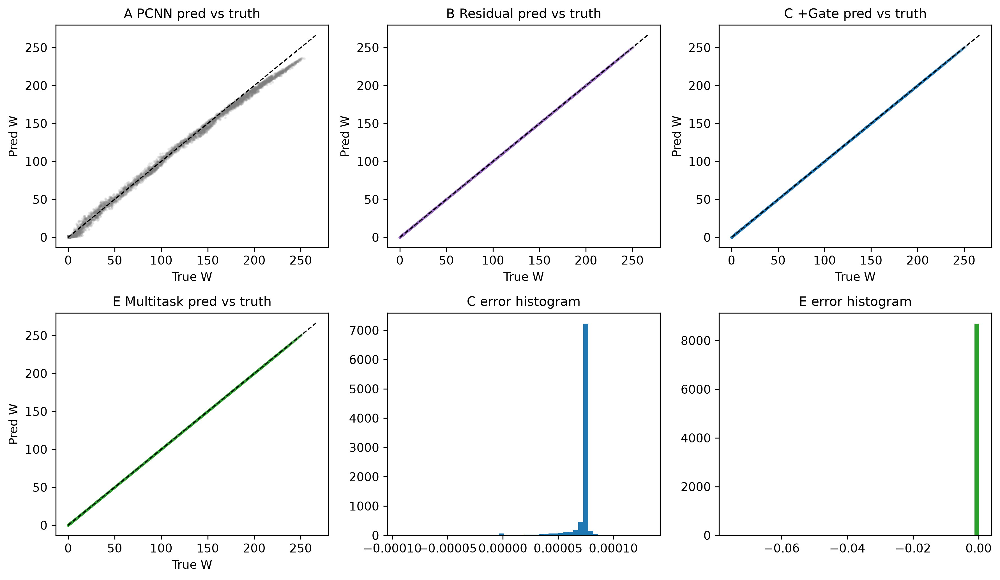 |
| Errors by regime | 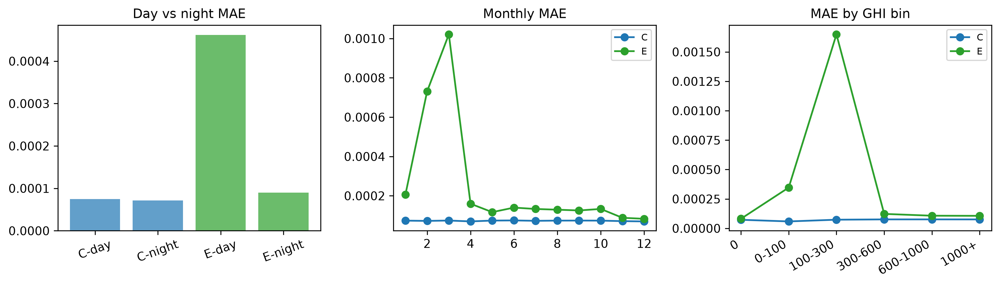 |

### Interpretability (gate & residual)

| Figure | Path |
|--------|------|
| Gate α — AR-PCNN | 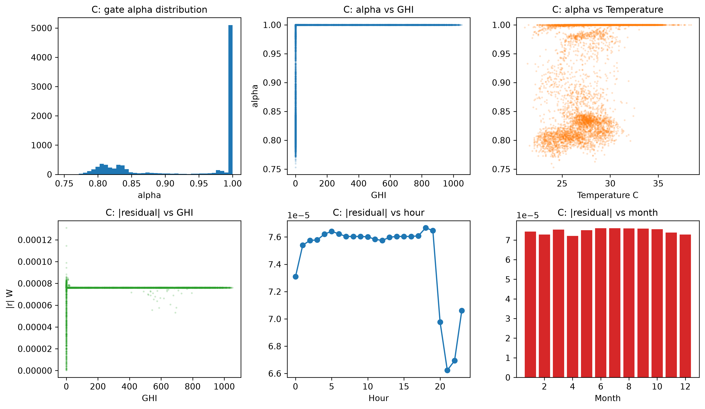 |
| Gate α — Multitask | 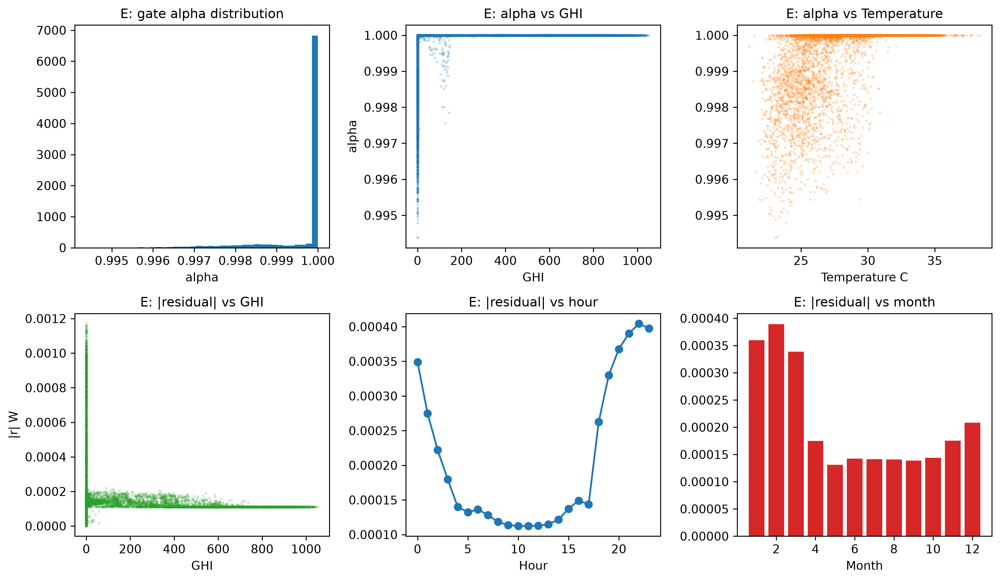 |
| Phase 9 gate (AR) | 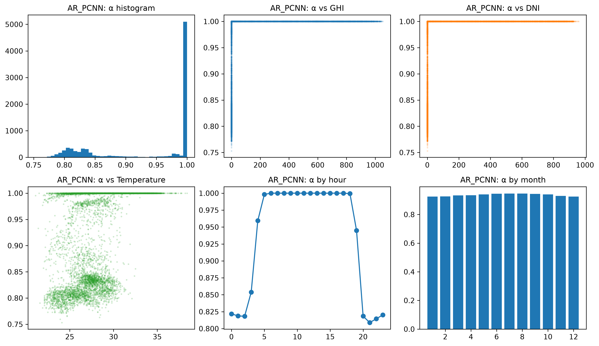 |
| Phase 9 residual | 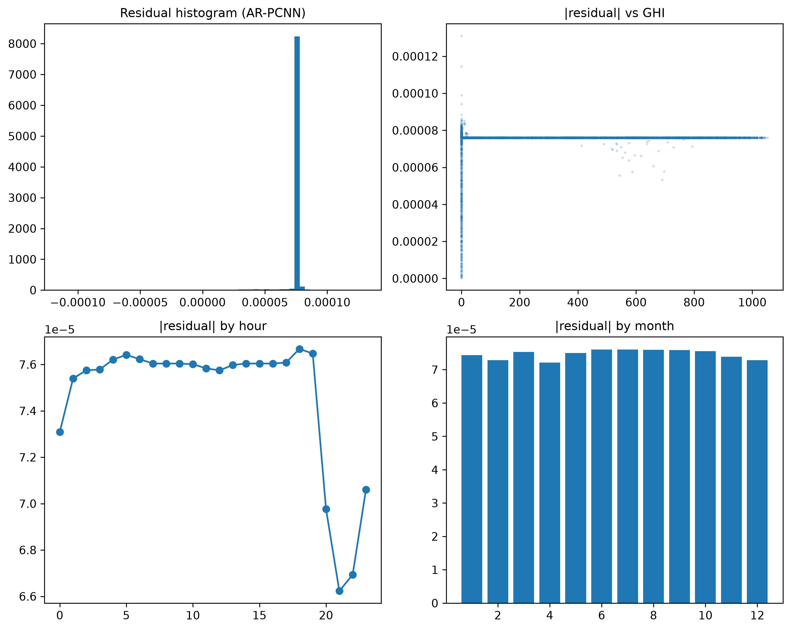 |

### Cross-domain & Case 1

| Figure | Path |
|--------|------|
| Case 1 ninja (baseline) | 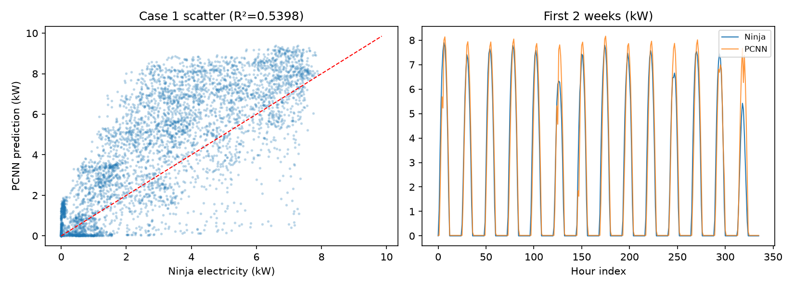 |
| Case 1 AR-PCNN | 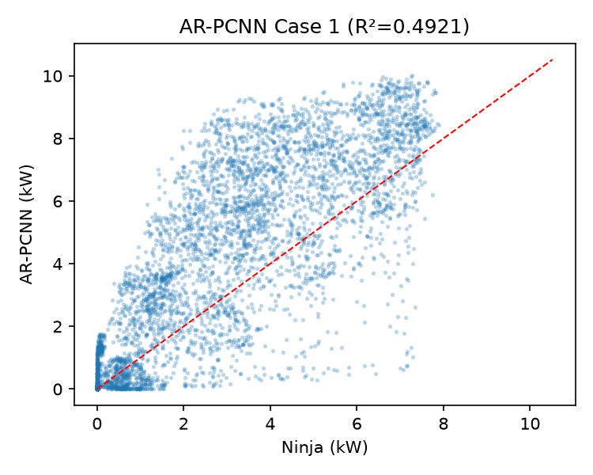 |
| Multitask ninja scatter | 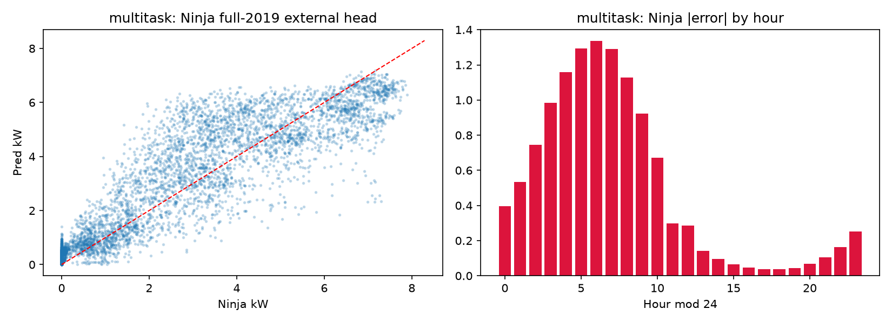 |
| Multitask NSRDB scatter | 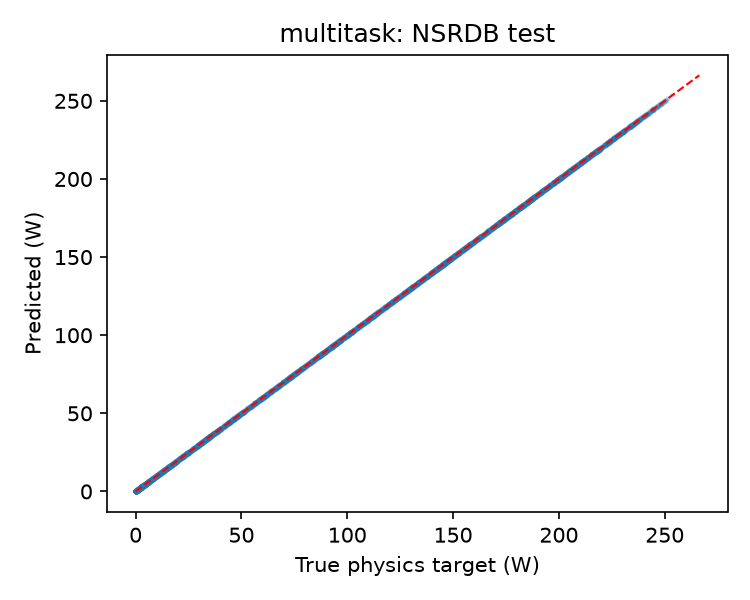 |
| Multitask UQ | 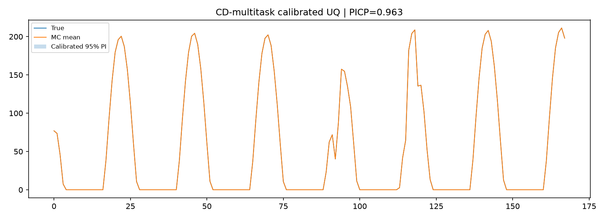 |

### Phase 9 extras

| Figure | Path |
|--------|------|
| Feature importance (AR) | 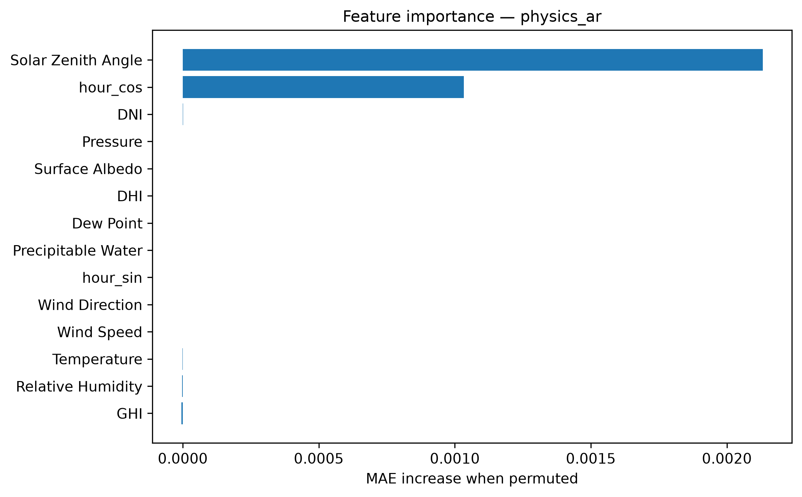 |
| Embeddings PCA (after multitask) | 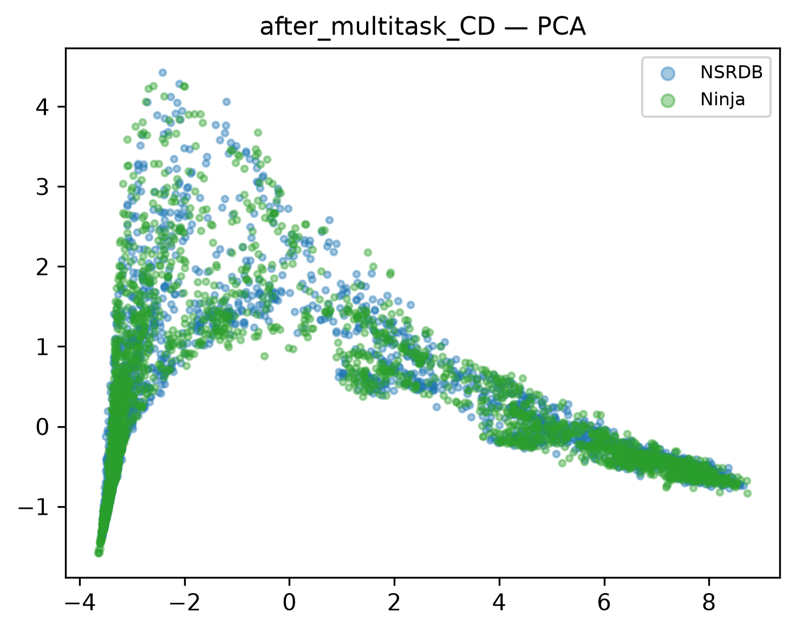 |
| Regime MAE | 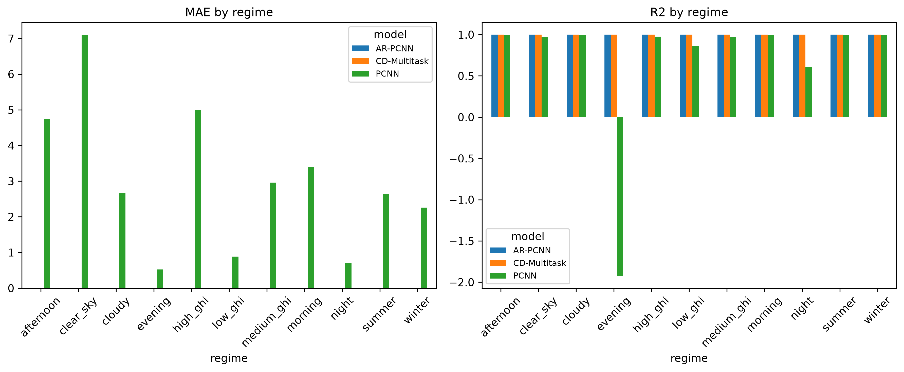 |
| Noise robustness | 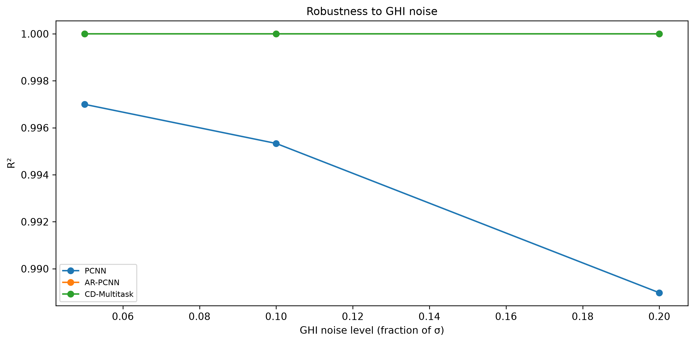 |
| Runtime / params | 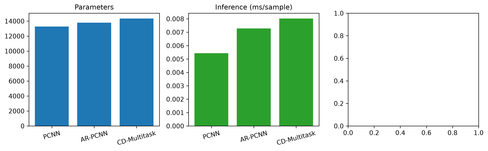 |

---

## 7. Repository layout

```text
Solar-PCNN-Research/
├── README.md                 # This file — architecture, how to run, figure gallery
├── requirements.txt          # Thin wrapper → Documentation/requirements.txt
├── Documentation/            # All phase reports, summary, interpret guide, deps, paper PDF
│   ├── README.md             # Doc index
│   ├── summary.md
│   ├── interpret.md
│   ├── phase4_limitations.md … phase9_report.md
│   ├── requirements.txt      # Canonical dependency list
│   ├── Solar.pdf
│   └── archive/              # Obsolete scratch (e.g. old IDE context prompt)
├── configs/                  # YAML train / preprocess configs
├── data/
│   ├── processed/            # Splits, scaler, ninja CSV
│   └── figures/              # All plots (phase4–9)
├── artifacts/
│   ├── checkpoints/          # *.pt models (frozen Phase 3–6)
│   ├── metrics/              # JSON / NPZ prediction arrays
│   └── phase9/               # Phase 9-only outputs (no overwrite of 3–8)
└── src/
    ├── data/                 # Pipeline
    ├── models/               # PCNN, AR-PCNN, CD, losses, metrics
    ├── training/             # Train / eval / UQ / Case 1
    └── analysis/             # Phase 4, 7, 8, 9
```

### Core code map

| Piece | Path |
|-------|------|
| Baseline PCNN | `src/models/pcnn.py`, `src/training/train.py` |
| AR-PCNN | `src/models/ar_pcnn.py`, `src/training/train_ar_pcnn.py` |
| Cross-domain | `src/models/ar_pcnn_cd.py`, `src/training/train_ar_pcnn_cd.py` |
| Metrics | `src/models/metrics.py` |
| Conformal UQ | `src/models/conformal.py` |
| Phase 7 runner | `src/analysis/phase7_run.py` |
| Phase 8 audit | `src/analysis/phase8_audit.py` |
| Phase 9 suite | `src/analysis/phase9/` |

---

## 8. Setup & how to run

### Environment

```powershell
cd E:\Solar-PCNN-Research
python -m venv .venv
.\.venv\Scripts\Activate.ps1
pip install -r requirements.txt
```

Use the **project `.venv`** (CUDA PyTorch). System / Store Python often breaks Torch (`torchgen.model` errors).

### Data prep (Phase 2)

```powershell
python -m src.data.pipeline
```

### Train / evaluate (Phases 3–6)

```powershell
# Baseline PCNN
python -m src.training.train
python -m src.training.evaluate --split test
python -m src.training.case1_ninja
python -m src.training.uncertainty --split test --n-samples 50

# AR-PCNN
python -m src.training.train_ar_pcnn
python -m src.training.evaluate_ar_pcnn --split test
python -m src.training.case1_ar_pcnn
python -m src.training.uncertainty_ar_pcnn --n-samples 50
python -m src.training.compare_phase5

# Cross-domain
python -m src.training.train_ar_pcnn_cd --strategy both
python -m src.training.evaluate_ar_pcnn_cd --strategy both
python -m src.training.uncertainty_ar_pcnn_cd --strategy both --n-samples 50
python -m src.training.compare_phase6
```

### Validation & audit (Phases 7–8)

```powershell
python -m src.analysis.phase7_run --n-mc 30
python -m src.analysis.phase8_audit
```

### Phase 9 analyses

```powershell
# Analysis using frozen checkpoints (fast)
python -m src.analysis.phase9.run_all --skip-train

# Full λ + multi-seed training into artifacts/phase9/ only (slow)
python -m src.analysis.phase9.run_all
```

Configs: `configs/train_pcnn.yaml`, `configs/train_ar_pcnn.yaml`, `configs/train_ar_pcnn_cd.yaml`.

---

## 9. Data & splits

| Item | Detail |
|------|--------|
| NSRDB | 2016–2020, 13.06°N, 80.25°E (~43,848 hours) |
| Paper site | VITCC ~12.84°N, 80.15°E (~25 km SW — disclosed) |
| Ninja | 2019 electricity (10 kW / 40×250 W) — external / multi-task only |
| Split | Chronological train → val → test: **28,062 / 7,016 / 8,770** |
| Scaler | Z-score **fit on train only** |
| Features | 14: GHI, DNI, DHI, Temperature, RH, Pressure, Albedo, Wind Speed/Dir, Dew Point, PW, Solar Zenith, hour_sin, hour_cos |
| Target | `target_power` ≈ physics-bounded panel Watts (TS250) |

Integrity (Phase 7/8): no timestamp overlap; 2020 test has **zero** ninja labels; Phase 5 never puts ninja in the loss.

---

## 10. Important caveats

Read these before claiming accuracy wins.

1. **NSRDB labels ≈ analytical physics** → near-unity R² for residual models is a consistency check, not a forecasting claim ([`Documentation/phase4_limitations.md`](Documentation/phase4_limitations.md)).
2. Prefer **Ninja val-holdout R² ≈ 0.81** over full-2019 **0.86** (early-2019 train overlap).
3. Report NSRDB as **R² ≈ 1.0** + MAE (W), not `R² = 1.0000`.
4. **λ-sensitivity:** full grid λ ∈ {0, 0.05, 0.1, 0.25, 0.5, 1.0} is in `artifacts/phase9/csv/exp01_lambda_sensitivity.csv` (Ninja peaks near λ≈0.25; λ=0 leaves the external head untrained → Ninja R²≈−0.51).
5. Site coordinates differ slightly from the paper’s VITCC point (~25 km) — disclose in methods.
6. **Do not align numeric tables to the source paper.** Our NSRDB MAE is **W** (1× panel); Case-1 is **kW** (10 kW system). The paper’s absolute MAE (e.g. 0.0213) does not state capacity/unit clearly enough to convert — **not reconcilable**; never guess `0.0213 kW = 21.3 W`.
7. `Feasible = 1.0` / hard physics clamps are architectural, not learned.
8. Prefer **sMAPE / nRMSE** over MAPE for external (ninja) relative error — MAPE inflates at near-zero irradiance.
9. Model D = Model C weights + conformal calibration only.
10. Put **units in every table row** (`MAE (W)`, `MAE (kW)`, `MPIW (W)`) — do not rely on section headers alone.

---

## 11. Documentation index

All reports live under [`Documentation/`](Documentation/README.md).

| Doc | Contents |
|-----|----------|
| [`Documentation/summary.md`](Documentation/summary.md) | Living plain-language project status |
| [`Documentation/phase4_limitations.md`](Documentation/phase4_limitations.md) | Why we redesigned |
| [`Documentation/phase5_comparison.md`](Documentation/phase5_comparison.md) | PCNN vs AR-PCNN |
| [`Documentation/phase6_comparison.md`](Documentation/phase6_comparison.md) | Cross-domain results |
| [`Documentation/phase7_validation.md`](Documentation/phase7_validation.md) | Ablation + integrity + stats |
| [`Documentation/phase8_audit.md`](Documentation/phase8_audit.md) | Independent metric verification |
| [`Documentation/phase9_report.md`](Documentation/phase9_report.md) | Evidence-audited Phase 9 claims |
| [`Documentation/interpret.md`](Documentation/interpret.md) | **Commands + how to read final numbers** |
| [`Documentation/requirements.txt`](Documentation/requirements.txt) | Python dependencies |
| [`README.md`](README.md) | Architecture + figure gallery |

---

## Citation / paper context

Reproduction and extension of work in the spirit of:

> *Physics-constrained neural networks for reliable solar power forecasting with uncertainty quantification* (Results in Engineering, 2026).

This codebase is a research implementation for fair comparison, diagnostics, and publication-oriented evidence — not a production forecasting service.

---

## Status badge (plain text)

```text
Phases 1–9  COMPLETE  |  Architecture FROZEN  |  Audit 178/178 PASS
Headline    Multitask CD: Ninja R² ~0.86 (val-holdout ~0.81) — primary claim
λ-sweep     Complete; Ninja peaks ~λ=0.25 (λ=0 = untrained-head control)
NSRDB       Physics-fidelity consistency only (labels physics-derived)
```
